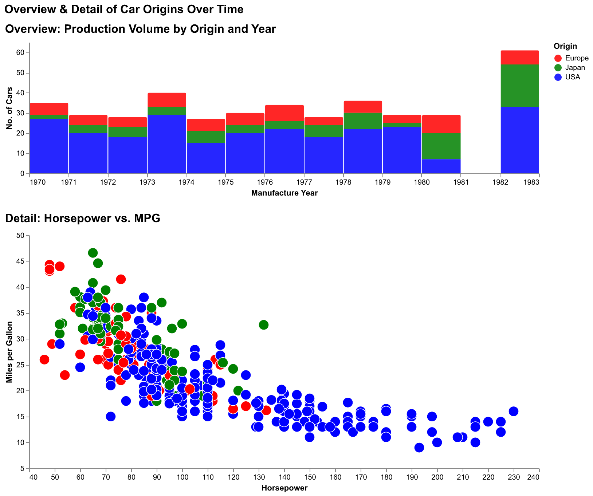

# Homework 1 — Overview and detail

> Adapt the interactive "Overview and Detail" figure to show the origins of
> production in Europe, the U.S. and Japan over time. Mouse hover and
> linking/brushing are expected. Submit as a stand-alone HTML page.

**[→ Open the interactive chart](solution.html)** · data: `vega-datasets` cars

## Approach

The figure follows Shneiderman's mantra — overview first, then detail on
demand. A stacked bar chart of how many models each region released per year
sits above a horsepower-versus-mileage scatter of the individual cars.

An **interval selection** on the overview drives the bars' colour through
`alt.condition`, so dragging across a span of years highlights it and greys out
the rest. A **point selection** on the scatter drives both opacity and size, so
hovering a car makes it stand out from the crowd. Tooltips on both views give
the per-mark detail: model name, origin, year, horsepower and mileage.

The pattern that emerges is the one the dataset is famous for — American cars
cluster at high horsepower and low mileage, Japanese and European ones at the
opposite corner, and the gap narrows through the late 1970s.
