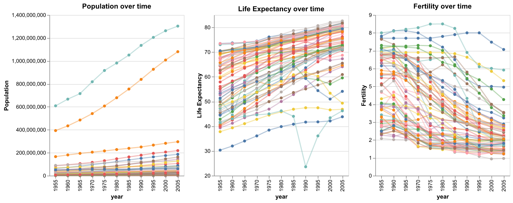

# Homework 2 — Linked panels on a year slider

> Adapt the interactive filtering plot to show change in population, life
> expectancy *and* fertility. Concatenate the three plots horizontally and link
> them to the slider. Submit as a stand-alone HTML page.

**[→ Open the interactive chart](solution.html)** · data: `vega-datasets` gapminder

## Approach

Three panels — population, life expectancy and fertility, each against year and
coloured by country — sit side by side.

The linking comes from a single shared parameter: **one** `selection_point`
bound to a range slider is added to all three panels rather than one slider
each. Because they share the parameter, dragging the slider filters the whole
row at once, and the three measures stay in step as you scrub through the
decades.
