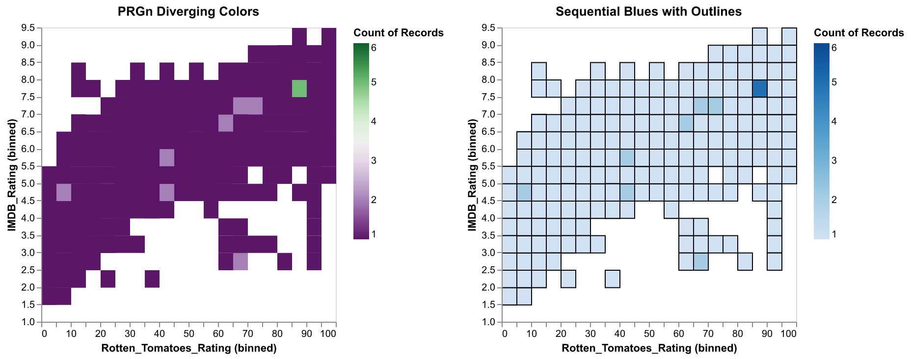

# Homework 3 — Diverging palette on a 2D histogram

> Adapt the two-dimensional histogram to create sharper transitions using the
> PRGn diverging palette. Then redo it with a sequential blue-to-white scheme
> scaled so low ranges are white, with cell outlines. Concatenate both
> horizontally and add tooltips.

**[→ Open the interactive chart](solution.html)** · data: `vega-datasets` movies

## Approach

The same binned heatmap of Rotten Tomatoes rating against IMDB rating is drawn
twice, side by side, so the two palettes can be compared directly on identical
data.

The **PRGn diverging** palette puts a bright midpoint between its two hues,
which makes the boundary between sparse and dense cells read as a sharp edge.
The **sequential blues** version is the more conventional choice for a count,
where there is no meaningful midpoint to diverge around — zero is simply the
low end. Cell outlines separate neighbouring bins that would otherwise blur
together. Tooltips on both report the bin ranges and the count.

The comparison is the point: a diverging scheme makes a threshold pop, a
sequential scheme represents magnitude honestly. Counts have no natural centre,
so the sequential version is the defensible one — the diverging palette is
drawing an edge that is not really in the data.
