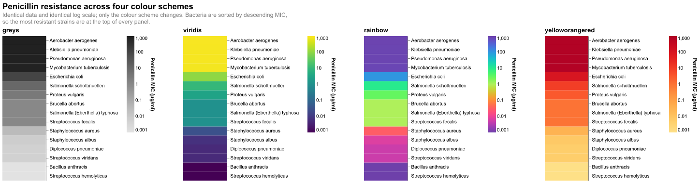
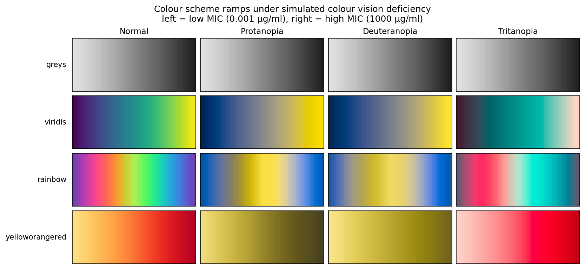

# Homework 4 — Colour schemes and accessibility

> Adapt the last chart into a small multiple with varying colour schemes:
> greys, viridis, rainbow, yelloworangered. Colour by concentration. Check for
> accessibility using Coblis, observe the differences and state your
> preference. Export as a single HTML file.

**[→ Open the interactive chart](solution.html)** · [notebook](solution.ipynb) ·
data: `vega-datasets` Burtin antibiotics

## Approach

Burtin's 1951 table gives the minimum inhibitory concentration (MIC) of three
antibiotics against 16 bacteria. MIC spans six orders of magnitude, so the
colour scale is **logarithmic** — on a linear scale every value but the largest
collapses into one end of the ramp. Bacteria are sorted by descending penicillin
MIC, so the most resistant strains are at the top of every panel.

One Altair detail worth recording: concatenated charts **share** a colour scale
by default, so without `resolve_scale(color='independent')` all four panels
render in the first scheme.

## Accessibility check

The assignment suggests Coblis. The same check is done numerically here so the
conclusion is reproducible rather than a matter of impression.

Each ramp is sampled from its own rendered output — the true Vega colours — then
transformed with the [Machado et al. (2009)](https://www.inf.ufrgs.br/~oliveira/pubs_files/CVD_Simulation/CVD_Simulation.html)
dichromacy matrices and compared in CIELAB, where Euclidean distance (ΔE)
approximates perceived difference.

**Total ΔE across the whole ramp** — how different the highest value looks from
the lowest:

| scheme | normal | protanopia | deuteranopia | tritanopia |
|---|---|---|---|---|
| greys | 78.6 | 78.6 | 78.6 | 78.6 |
| **viridis** | **149.0** | **145.5** | **135.0** | 76.0 |
| rainbow | **0.0** | 0.0 | 0.0 | 0.0 |
| yelloworangered | 82.9 | 68.0 | 50.5 | 78.8 |

## What the numbers show

**`rainbow` scores 0.0 for every vision type, including normal.** It is a cyclic
scheme — it begins and ends on the same purple. Look at the rainbow panel in the
chart above: the most resistant bacteria at the top and the least resistant at
the bottom are coloured almost identically. This is not an accessibility problem,
it is the wrong scheme for a sequential quantity, for every viewer.

**`yelloworangered`** degrades the most: full range for normal vision, but 39%
of it lost under deuteranopia, where yellow-to-red flattens to yellow-to-olive.

**`greys`** is identical under every simulation — it carries no chroma to lose.
Perfectly safe, but the smallest minimum step of the usable schemes, so fine
distinctions are hard to read.

## Preference: viridis

Widest perceptual range of the four (ΔE 149), retaining 98% of it under
protanopia and 91% under deuteranopia, and — the property that actually matters
for a sequential quantity — it stays **monotonically ordered** under every
simulation. It was designed for this. Its weakness is tritanopia, where the
range roughly halves to 76; tritanopia is also by far the rarest form.

`greys` is the fallback when the figure must survive photocopying as well.
