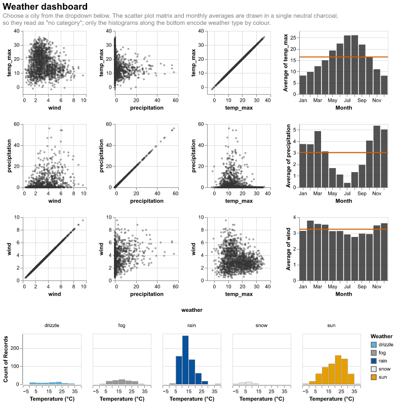
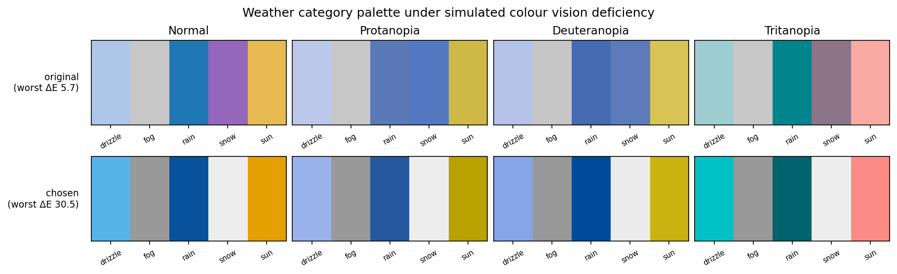

# Homework 5 — City dropdown and an accessible palette

> Adapt the last chart to add a dropdown menu for the different cities in the
> data. Consider another colour for the SPLOM base chart to easily differentiate
> it from the rain categorical encoding. Check for accessibility using Coblis
> and adjust colours accordingly. Export as a single HTML file.

**[→ Open the interactive dashboard](solution.html)** · [notebook](solution.ipynb) ·
data: `vega-datasets` weather (Seattle & New York, 2012–2015)

## The dashboard

All four composition operators in one view: `repeat` for the scatter plot
matrix, `layer` + `repeat` for the monthly averages with their mean rules,
`facet` for the temperature histograms, and `concat` to assemble it.

The city filter is a **variable parameter** bound to a `select` input, declared
once at the top level and consumed by a single `transform_filter`. Because the
filter sits above the whole composition, one dropdown drives the SPLOM, the
monthly averages and the histograms together.

### A trap in the data source

`vega_datasets`' `weather` attribute points at a **different dataset** — a
forecast table with `day` / `record` / `normal` columns and no `location` field.
Filtering it by city produces an entirely empty dashboard and no error. The
Seattle and New York series live in `weather.csv`.

## Accessibility

The original palette has a problem invisible to normal vision. Measured in
CIELAB after applying the [Machado et al. (2009)](https://www.inf.ufrgs.br/~oliveira/pubs_files/CVD_Simulation/CVD_Simulation.html)
dichromacy matrices, its worst pair is **rain versus snow at ΔE 5.7 under
protanopia** — effectively the same colour. In the figure below, the top row
shows exactly that collapse.

Rather than guess a replacement, I fixed a small set of semantically acceptable
hues per category — drizzle a light blue, rain a darker blue, fog grey, snow
near-white, sun warm — and searched for the assignment maximising the *worst*
pairwise separation across normal vision and all three dichromacies.

Constraining first matters: optimising without semantic constraints yields a
palette scoring ΔE 31.0 that assigns **black to sun and yellow to drizzle**.
Perceptually ideal, completely unreadable as weather.

| | worst-case ΔE across all vision types |
|---|---|
| original | 5.7 |
| **chosen** | **30.5** |

| category | colour | |
|---|---|---|
| drizzle | `#56B4E9` | light blue |
| fog | `#999999` | grey |
| rain | `#08519C` | deep blue — heavier rain reads darker |
| snow | `#EDEDED` | near-white |
| sun | `#E69F00` | orange |

A 5.4× improvement, and the limiting pair is now fog against snow with an
**identical ΔE under every vision type** — because those two differ in
*lightness* rather than hue, and dichromacy leaves lightness essentially intact.
That is the general lesson: separating categories by lightness rather than hue
is what makes a palette robust.

## The SPLOM colour

The SPLOM encodes no category, so its colour must not look like one. Altair's
default `#4c78a8` sits right beside the blues used for rain and drizzle — the
exact confusion the assignment asks to avoid.

Each candidate was scored by its distance to the *nearest* weather colour, under
every vision type:

| candidate | | min ΔE |
|---|---|---|
| **charcoal** | `#333333` | **29.4** ← chosen |
| vermillion | `#D55E00` | 18.3 |
| Altair default | `#4c78a8` | 13.4 |
| bluish green | `#009E73` | 11.9 |
| reddish purple | `#CC79A7` | 7.1 |

Worth recording that my first instinct — Okabe-Ito's bluish green, a palette
designed for colour-vision safety — scored *worse than the default* here, because
safety within a palette says nothing about distance to a different palette.
Charcoal wins on the measurement and also reads as "neutral, not a category".
