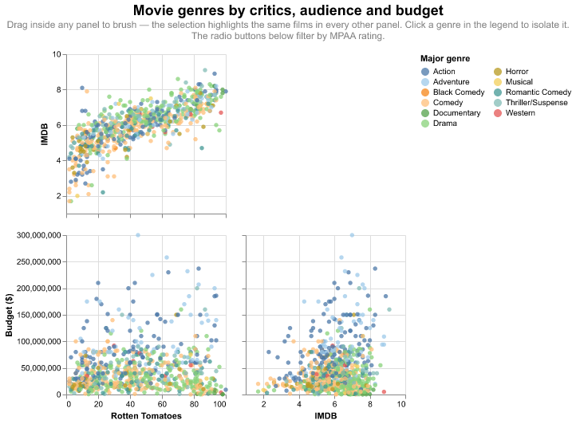

# Homework 6 — Genre SPLOM with linking and brushing

> Adapt the last chart in *Binding Selections to Multiple Inputs*, preserving
> the rating option but creating a SPLOM to show the Movie Genres. Include
> linking and brushing. Check that all functionalities work as intended. Add a
> main title and centre the rating selection underneath. Export a single HTML
> file.

**[→ Open the interactive chart](solution.html)** · [notebook](solution.ipynb) ·
data: `vega-datasets` movies

## Approach

The original chart binds one selection to two widgets — a genre dropdown and an
MPAA radio — and uses it to fade points in a single scatter plot. Replacing the
genre dropdown with a SPLOM changes genre from something you *query* into
something you *see*: it becomes a colour encoding across every pairwise plot,
with a clickable legend taking over the filtering job.

Three selections, each with a distinct role:

| selection | type | job |
|---|---|---|
| `rating` | point, bound to radio | the preserved widget — drives a `transform_filter`, so it removes films rather than fading them |
| `brush` | interval, `resolve='global'` | registered on every panel; one shared parameter is what makes brushing *linked* |
| `genre` | point, bound to legend | click a genre to isolate it across the whole matrix |

`brush` and `genre` are combined as `brush & genre` in the conditional
encodings, so a film must satisfy both to stay highlighted.

### Why not `repeat()`

`repeat()` is the usual way to build a SPLOM, but it always produces a full
square grid, cannot label axes per field, and shows every pair twice either side
of a redundant diagonal. Building the lower triangle explicitly gives each pair
once, with the x field constant down each column and the y field constant across
each row, and axis labels only on the outer edges.

### Centring the rating selector

Vega-Embed renders bound inputs into a `.vega-bindings` block below the chart,
left-aligned, and no Altair option changes this — it is page layout, not chart
spec. The exported HTML therefore carries a small stylesheet that flexes that
block to centre.

## Verified, not assumed

The assignment asks to check that all functionality works, so it was tested in
a browser:

- **brushing links across panels** — brushing Rotten Tomatoes 40–70 and IMDB
  6–7.5 in the top panel collapsed the highlighted points in *both* lower panels
  to exactly that range
- **the MPAA radio filters** — selecting NC-17 leaves a handful of films, and
  the legend shrinks to only the genres still present
- **the radio buttons render centred** beneath the chart
- **the legend isolates a genre** on click
