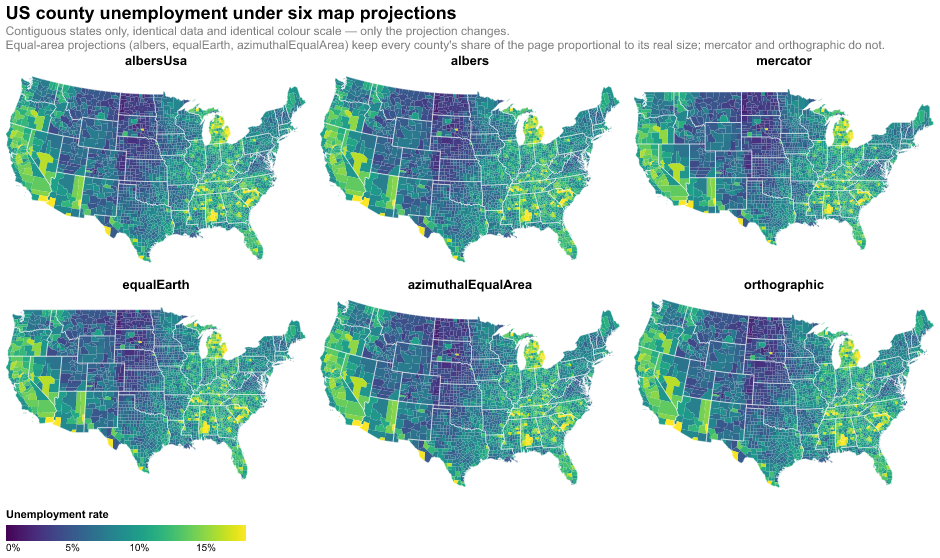
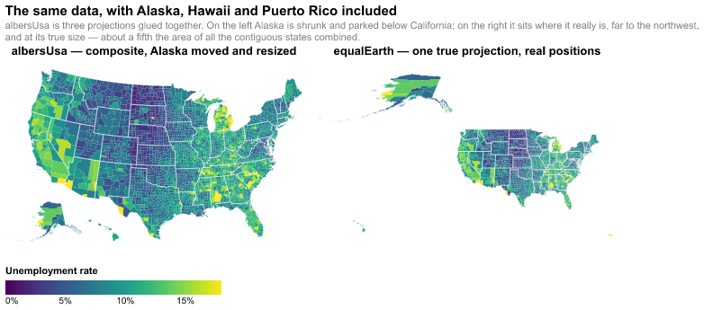

# Homework 7 — Map projections

> Adapt the small multiple chart to show unemployment rates and change the
> projection types. Observe the changes and appreciate the distances among
> regions. Consider your favourite projection and explain your decision. Add a
> main title. Export as a single HTML file.

**[→ Open the interactive chart](solution.html)** · [notebook](solution.ipynb) ·
data: `vega-datasets` county unemployment + `us-10m`

## Approach

A projection is a property of a **chart**, not an encoding channel, so neither
`facet()` nor `repeat()` can iterate over projections — the small multiple has
to be six separate charts, concatenated.

Two things only surfaced on rendering:

**Auto-fitting.** Vega-Lite fits a projection to its data extent. The county
file includes Alaska, Hawaii and Puerto Rico, so a non-composite projection must
span the Aleutians to the Caribbean and the mainland collapses to a smudge. The
grid is therefore restricted to the contiguous states, where the six
projections are directly comparable.

**Rotation.** Azimuthal projections default to centring on (0°, 0°), off the
west coast of Africa, which leaves the US on the rim at a steep oblique angle.
They need an explicit rotation of (−lon, −lat) of the intended centre; conic
and pseudocylindrical projections carry a sensible centre in their parameters
already.

## Measuring the distortion

Rather than assert which projections preserve area, I measured it. For each
projection the local area scale factor is computed on a grid over the contiguous
US by finite differences — transform a point and two neighbours a small step
away in longitude and latitude, take the Jacobian determinant, divide by the
true area element `cos(lat)`. For an equal-area projection that factor is
constant; the **spread** is how unevenly a projection inflates one region
against another.

| projection | area spread | equal-area? |
|---|---|---|
| albers | 1.005 | yes |
| equalEarth | 1.005 | yes |
| azimuthalEqualArea | 1.005 | yes |
| orthographic | 1.131 | no |
| **mercator** | **1.914** | **no** |

The three equal-area projections land at 1.005, the residual of the
finite-difference step and the ellipsoid — effectively 1.000, as theory
requires. **Mercator spreads by 1.91:** a county on the Canadian border takes up
roughly **91% more of the page per square kilometre** than one on the Gulf
coast.

Raw numbers in [`distortion.csv`](distortion.csv).

## What albersUsa hides

[→ open the comparison](albersusa_comparison.html)

`albersUsa` is not one projection but three glued together, with Alaska scaled
down and Alaska and Hawaii relocated beneath the southwest. It is the
conventional choice and it is very readable, but by construction it answers
"how big is Alaska" and "where is Alaska" incorrectly — Alaska is really about
a fifth the area of all the contiguous states combined, and lies far to the
northwest.

## Preference: Albers equal-area conic

For a choropleth this is not an aesthetic choice. The visual weight of a region
*is* its area on the page, so a projection that inflates northern states
inflates the reader's impression of how much of the country is unemployed.
Mercator is conformal — it preserves angles, which is what made it useful for
navigation, and it is precisely the wrong trade for a map whose entire message
is carried by filled area.

Among the three equal-area candidates, Albers suits this map best: its two
standard parallels can be placed to bracket the latitudes of the contiguous US,
keeping *shape* distortion low across exactly the region shown, whereas Equal
Earth and azimuthal equal-area are optimised for the whole globe.
