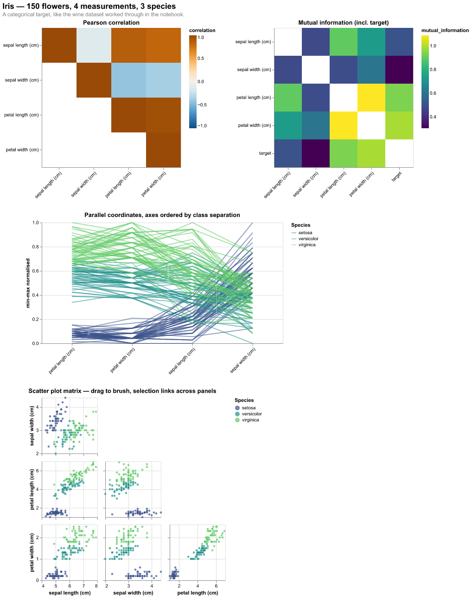
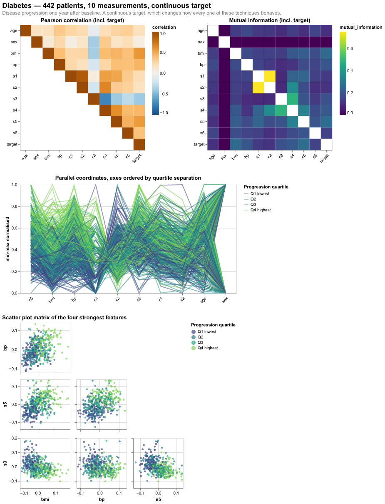

# Homework 8 — Exploratory data analysis

> Use everything you learned in this notebook to explore and analyze the
> `ori.dat` data set, using pandas' `read_csv` with adequate parameters. Export
> your resulting data visualizations as a multi-HTML file.

**[→ Open the full report](solution.html)** · [notebook](solution.ipynb) ·
[iris only](iris.html) · [diabetes only](diabetes.html)

## A note on the dataset

`ori.dat` was not obtainable — it is not distributed with the course notebooks
and I could find no trace of it anywhere. Rather than invent an analysis of
data I never saw, I applied the identical technique set to the two datasets the
notebook itself sets aside for this purpose:

> *"we will import 3 different data sets, among which two of them have
> categorical and one has continuous target variables. Through this notebook,
> we will only deal with one data set, named `data_wine`... You should repeat
> exploratory analysis with two other data sets."*

So: **iris** (categorical target, like wine) and **diabetes** (continuous
target). The second is the more useful half — a continuous target changes how
every one of these techniques behaves, which a third classification dataset
would not have exposed. Swapping `ori.dat` in later is a one-line data change.

## Iris — 150 flowers, 4 measurements, 3 species

The petals carry almost all the class information:

| feature | mutual information with species |
|---|---|
| petal width | 0.989 |
| petal length | 0.936 |
| sepal length | 0.506 |
| sepal width | 0.306 |

Roughly three times as much in the petals as in sepal width, and the parallel
coordinates show why — on the petal axes *setosa* separates completely from the
other two species, with no overlap. The two petal measurements are also nearly
redundant with each other (**r = +0.963**), so one would do most of the work
alone. Sepal width is the odd feature out: the only one negatively correlated
with the rest, and the weakest discriminator.

## Diabetes — 442 patients, 10 measurements, continuous target

| feature | r with target | MI with target |
|---|---|---|
| bmi | +0.586 | 0.259 |
| s5 | +0.566 | 0.267 |
| bp | +0.441 | 0.202 |
| s4 | +0.430 | 0.209 |
| s3 | **−0.395** | 0.185 |
| sex | +0.043 | 0.007 |

Correlation and mutual information rank the features almost identically, which
is itself the finding: the relationships here are largely **linear**, so
correlation is not leaving much on the table. Where they diverge is
informative — `s3` is the only strongly *negative* correlation, and mutual
information cannot see that, because it measures dependence without direction.

Two things the matrices expose that a summary table would not:

**`s1` and `s2` are nearly the same variable.** MI 0.753, |r| 0.897 — by far
the strongest pair in the dataset. They are total serum cholesterol and LDL,
which are biologically coupled. Feeding both to a model adds collinearity
without adding information.

**`sex` carries essentially nothing here** — MI 0.007, r 0.043. It is also
binary, so its parallel-coordinate axis collapses to two points, visible as the
degenerate axis at the right-hand end of the diabetes plot.

## Technique notes

**Where the target belongs.** For diabetes the target is a real quantity, so
correlating features against it is meaningful. For iris it is a nominal label
coded 0/1/2 — an arbitrary coding, so Pearson correlation against it would be a
number without a meaning. It is excluded from the correlation matrix but kept
in the mutual information matrix, which only needs the labels to be discrete.

**Masking the MI diagonal.** A variable's mutual information with itself is its
own entropy, about log(10) ≈ 2.3 at this bin count — several times any
off-diagonal value, flattening the rest of the matrix to one colour. Dropping
the diagonal lets the colour scale span only the comparisons that carry
information.

**Separate colour scales.** Correlation runs −1…1 and mutual information
0…entropy, so the two matrices must not share a scale; without
`resolve_scale(color='independent')` the MI values fall outside the correlation
domain and clamp to black.

**Quartiles for a continuous target.** Diabetes progression cannot drive a
categorical colour legend directly, so it is cut into quartiles for the
parallel coordinates and the scatter plot matrix.
